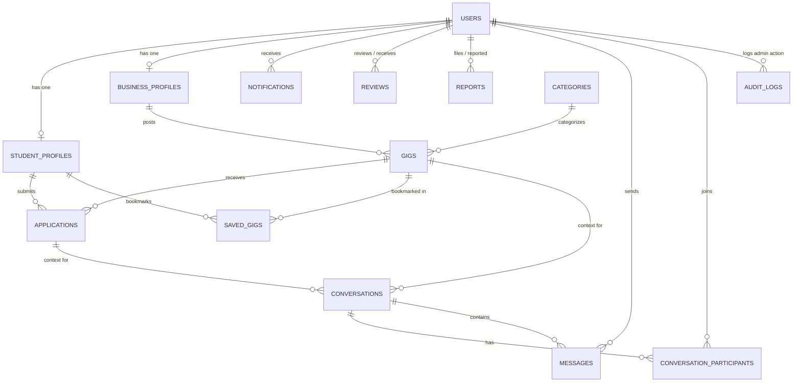

# GigCampus &mdash; Hyperlocal Student Gig Marketplace
> **"Local Businesses. Student Talent. Real Opportunities."**

GigCampus is a full-stack web application designed for **Erode District, Tamil Nadu**, connecting local MSMEs (textile wholesale shops on Brough Road, powerloom units in Veerappanchatram, retail traders, machinery fabricators, agricultural businesses) with engineering and arts college students seeking practical digital freelance experience and paid gigs.

---

## 1. System Architecture

GigCampus follows a clean, modular, layered architecture adhering to Spring Boot best practices:

```
[ Browser / Mobile Client (HTML5 / Bootstrap 5 / SockJS / STOMP.js) ]
             │
             ▼
[ Security Filter Chain (Spring Security 6) ]
  ├── BCrypt Password Hashing
  ├── Session Management & CSRF Token Protection
  ├── WebSocket Handshake Protection (/ws/**, /ws-direct/**)
  └── Role-Based Access Control (ROLE_STUDENT, ROLE_BUSINESS, ROLE_ADMIN)
             │
             ▼
[ Controller Layer (Spring MVC + WebSocket STOMP + REST) ]
  ├── PublicController (Home, Browse Gigs, Browse Talent, Services, About, Contact, Password Reset)
  ├── AuthController (Login, Student & Business Registration, Hub)
  ├── StudentController (Profile, Proposals, Saved Gigs, Active Projects, Reviews)
  ├── BusinessController (Profile, Post/Edit Gigs, Applicant Review, Verification)
  ├── AdminController (Platform Metrics, Verifications, Gigs, Moderation, Audit Logs)
  ├── ChatWebController & ChatApiController (Live Chat UI, REST message history)
  ├── ChatWebSocketController (@MessageMapping STOMP real-time message handler)
  └── NotificationController & NotificationApiController (Alerts, STOMP push, unread badges)
             │
             ▼
[ Service Layer (Business Logic & Real-Time Dispatch) ]
  ├── UserService (Registration, Authentication, Verification workflow, Talent Search)
  ├── GigService (Posting, Multi-criteria Search & Filter, Ownership checks)
  ├── ApplicationService (Proposal submissions, Duplicate checks, Status transitions)
  ├── ChatService (Real-time message persistence & STOMP /topic/conversation.* broadcast)
  ├── NotificationService (SimpMessagingTemplate STOMP /topic/notifications.* push)
  ├── SavedGigService (Student bookmarking & bookmark management)
  ├── AuditLogService (Admin intervention logging & history)
  └── ReviewService (Post-completion ratings, Profile score recalculation)
             │
             ▼
[ Data Access Layer (Spring Data JPA) ]
  └── JpaRepositories (13 JPA Repository Interfaces)
             │
             ▼
[ Relational Database (MySQL 8 / H2 in-memory mode / Flyway Migrations) ]
  ├── Schema: V1__init_schema.sql
  ├── Categories & Seed: V2__seed_categories_and_data.sql
  └── Real-Time Chat & Audit: V3__chat_saved_gigs_and_audit.sql
```

---

## 2. Entity-Relationship (ER) Diagram



---

## 3. Implemented Features & Page Structure

### Public Pages
- **Home (`/`)**: Dynamic landing page featuring headline, live database platform statistics, category cards, featured open gigs, how it works, student & business benefits, safety guidelines, and FAQ accordion.
- **Browse Gigs (`/gigs`)**: Multi-filter search by keyword, category, work mode (Remote/On-Site/Hybrid), and budget range.
- **Gig Details (`/gigs/{id}`)**: Full task scope, business details, verified badge, budget, save gig bookmarking, and student proposal application form.
- **Browse Talent (`/students`)**: Public talent directory where local shops can search engineering undergraduates by skills, department, college, or location.
- **Services (`/services`)**: Comprehensive catalog of top student capabilities (Web Development, Poster Design, Google Business SEO, Inventory Excel, Software/Billing setup, Translation) with deliverables and Erode price estimates.
- **How It Works (`/how-it-works`)**, **About (`/about`)**, **Contact (`/contact`)**.
- **Privacy Policy (`/privacy`)**, **Terms of Service (`/terms`)**.
- **Custom Error Pages**:
  - `error/404.html` (Not Found)
  - `error/403.html` (Access Denied)
  - `error/500.html` (Server Error)

### Authentication & Roles
- **Login (`/login`)**: Secure authentication via Spring Security and BCrypt.
- **Student Registration (`/register/student`)**: Captures name, email, password, phone, college, department, year, skills, and bio.
- **Business Registration (`/register/business`)**: Captures business name, category, owner details, GSTIN, and location. New accounts default to `UNVERIFIED`.
- **Forgot Password (`/forgot-password`)** & **Reset Password (`/reset-password`)**.

### Real-Time Feature 1: Live Chat (`/chat`)
- **Technology**: Spring WebSocket + STOMP Messaging + SockJS + MySQL JPA persistence.
- **Authorized Rooms**: Only participants (the applicant student and gig owner business) can join the conversation.
- **Split-Pane UI**: Searchable conversation list on the left, active chat stream on the right with real-time bubble insertion, timestamps, sender badges, and connection status indicator.
- **Instant Delivery**: Messages sent over `/app/chat.sendMessage` are persisted to MySQL and instantly broadcasted to `/topic/conversation.{id}`. Fallback REST API `/api/chat/messages` is also integrated.

### Real-Time Feature 2: In-App Live Notifications
- **Technology**: Spring WebSocket/STOMP + MySQL + Bootstrap Toast alerts.
- **Instant Push**: Triggered on proposal submissions, status updates (ACCEPTED / REJECTED), gig completion, reviews, and new chat messages.
- **Live Navbar Badge**: Unread count badge increments live without page reloads.
- **Toast Popups**: High-priority real-time alerts appear at the bottom-right of the screen with a direct link to the relevant project or chat.
- **Notifications Hub (`/notifications`)**: History view with mark-as-read and mark-all-read capabilities.

### Student Dashboard (`/student/dashboard`)
- Profile completion and metric statistics.
- **My Applications (`/student/applications`)**: Pending proposals, status tracking, withdrawal option, and direct Live Chat button.
- **Saved Gigs (`/student/saved-gigs`)**: Bookmarked gigs for quick review.
- **Active Projects (`/student/projects`)**: Accepted assignments with client contact information and live chat.
- **Completed Gigs (`/student/completed`)**: Completed projects and review submission.
- **Profile Management (`/student/profile`)**: Manage skills, portfolio link, GitHub, LinkedIn, and bio.

### Business Dashboard (`/business/dashboard`)
- Metric summary (total gigs, open gigs, active projects, completed).
- **Post a Gig (`/business/gigs/new`)**: Full gig creation form.
- **Edit Gig (`/business/gigs/{id}/edit`)** & status management (Open, In Progress, Closed).
- **Review Applicants (`/business/gigs/{id}/applicants`)**: View student proposals, quotes, portfolio links, direct Live Chat button, and Accept/Decline actions.
- **Mark Work Completed & Review**: Finalizes project and opens student review form.
- **Business Profile & Verification Request (`/business/profile`)**: Submit GSTIN / registration details for admin review.

### Admin Dashboard (`/admin/dashboard`)
- **Platform Analytics**: Verified student counts, registered shops, gigs, and completion ratios.
- **Verification Review (`/admin/verifications`)**: Inspect business credentials, approve or reject with custom notes.
- **User Management (`/admin/students`, `/admin/businesses`)**: Toggle active/suspended user status.
- **Gig Moderation (`/admin/gigs`)**: Update or close inappropriate listings.
- **Audit Logs (`/admin/audit-logs`)**: Complete chronological audit trail of all administrative actions.

---

## 4. Test Accounts & Pre-Seeded Fictional Data

The development profile (`dev`) automatically seeds realistic, clearly labeled fictional development data:

| Role | Email | Password | Details |
|---|---|---|---|
| **Administrator** | `admin@gigcampus.local` | `Admin@GigCampus2026` | Erode District Moderator |
| **Student 1** | `priya.erode@kongu.edu.in` | `Student@123` | Final Year CSE, Kongu Engineering College |
| **Student 2** | `karthik.bannari@bitsathy.ac.in` | `Student@123` | Third Year IT, Bannari Amman Institute |
| **Business 1** | `kaveri.handlooms@sample-erode.local` | `Business@123` | Kaveri Handlooms & Textiles (Verified) |
| **Business 2** | `krishna.spares@sample-erode.local` | `Business@123` | Sri Krishna Powerloom Spares (Pending) |

---

## 5. How to Run Locally

### Prerequisites
- Java 21 or higher (JDK 21+)
- Maven (included via `mvnw.cmd` wrapper)
- MySQL 8 (optional; defaults to zero-config in-memory H2 development database when running with active profile `dev`)

### Step 1: Clone and Configure Environment
Copy `.env.example` to `.env` or run with default settings:
```bash
cp .env.example .env
```

### Step 2: Run Automated Tests
```bash
# On Windows
.\mvnw.cmd test

# On Linux / macOS
./mvnw test
```
All 24 automated test cases will run and report `BUILD SUCCESS`.

### Step 3: Start the Application
To run in standalone development mode (zero-config, pre-seeded sample data, H2 in MySQL mode):
```powershell
.\mvnw.cmd spring-boot:run -Dspring-boot.run.profiles=dev
```

To run with local MySQL 8 database:
```powershell
# Ensure database 'gigcampus' exists in MySQL
mysql -u root -p -e "CREATE DATABASE IF NOT EXISTS gigcampus CHARACTER SET utf8mb4 COLLATE utf8mb4_unicode_ci;"

.\mvnw.cmd spring-boot:run -Dspring-boot.run.profiles=mysql
```

The application will be accessible at:
👉 **http://localhost:8080**

H2 Console (in `dev` mode):
👉 **http://localhost:8080/h2-console** (JDBC URL: `jdbc:h2:mem:gigcampus_dev`, User: `sa`, Password: blank)

---

## 6. How to Test Real-Time Features Manually

### Testing Real-Time Feature 1: Live Chat
1. Open two different browser windows (e.g. regular window and incognito window).
2. **Window 1 (Student)**: Log in as `priya.erode@kongu.edu.in` / `Student@123`. Navigate to `/chat`.
3. **Window 2 (Business)**: Log in as `kaveri.handlooms@sample-erode.local` / `Business@123`. Navigate to `/chat`.
4. Both will see the active thread: *"Discussion: 5-Page Responsive Showcase Website for Textile Wholesale Shop"*.
5. Type a message from Window 1 and press Enter.
6. Notice that the message appears immediately in Window 2 without refreshing the page!

### Testing Real-Time Feature 2: Live In-App Notifications
1. Keep **Window 1 (Student)** logged in on any page (e.g., Home or Dashboard).
2. In **Window 2 (Business)**, go to `/business/dashboard` -> click on an applicant and accept or decline their proposal.
3. Observe **Window 1 (Student)**:
   - The red notification badge on the bell icon increments live!
   - A real-time toast alert pops up at the bottom right corner with sound/visual cue.
   - Clicking "View" navigates directly to the updated project!

---

## 7. Technology Stack Summary

- **Backend**: Java 21, Spring Boot 3.3.5, Spring Security 6, Spring Data JPA, Spring WebSocket, STOMP, SockJS.
- **Frontend**: HTML5, Vanilla CSS Design System, Bootstrap 5.3, Bootstrap Icons, Thymeleaf Templates.
- **Database & Migrations**: MySQL 8 / H2 in-memory MySQL mode, Flyway Migrations (V1, V2, V3).
- **Testing**: JUnit 5, Spring Boot Test, MockMvc (24 tests passing).
